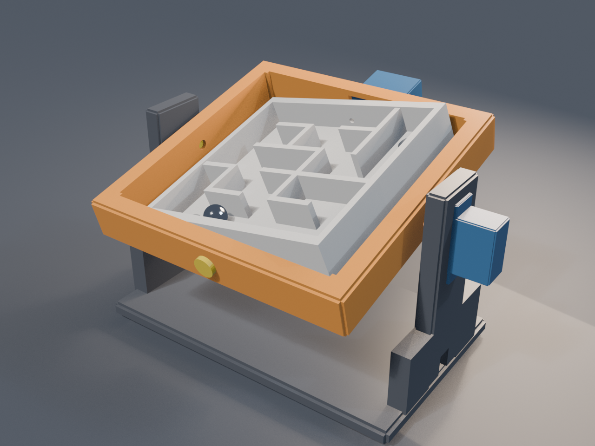
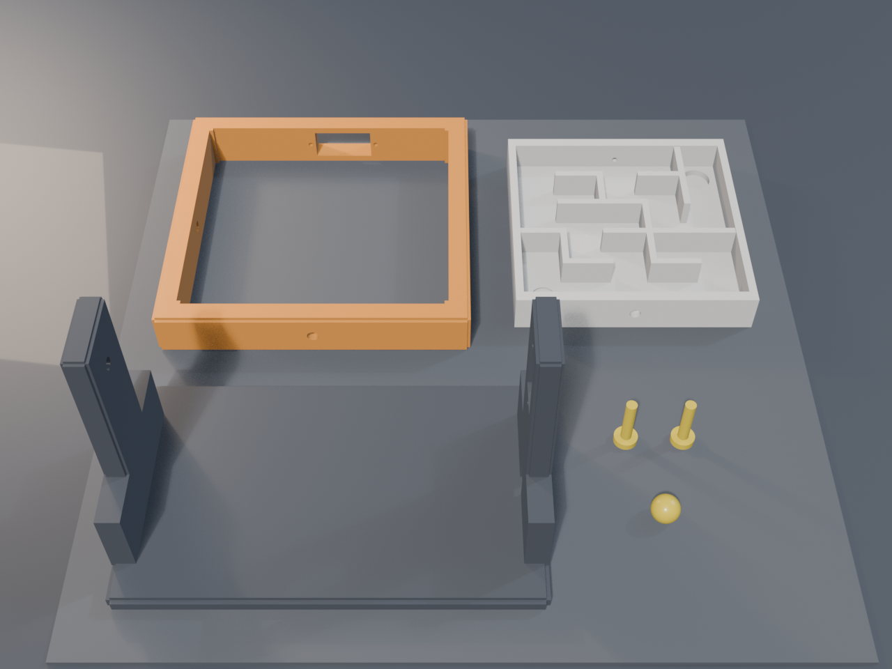
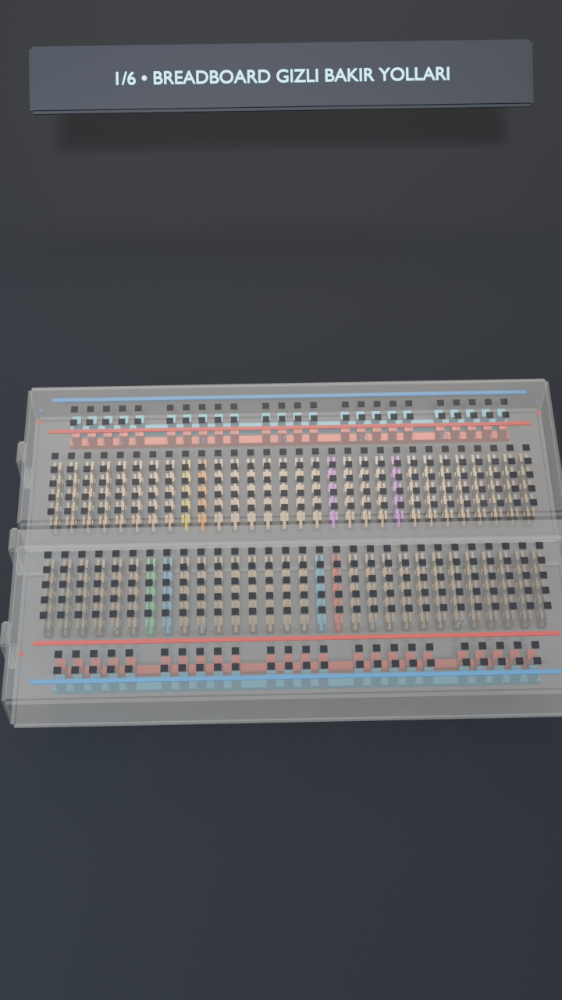
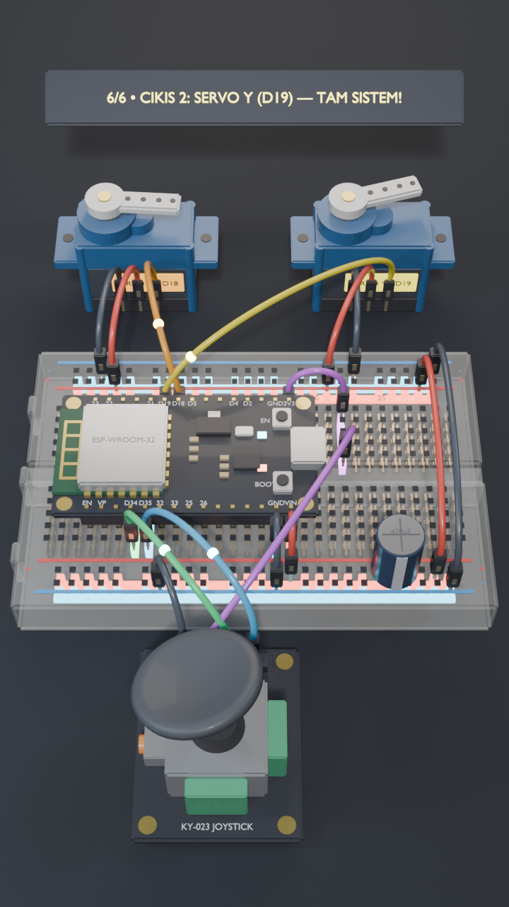
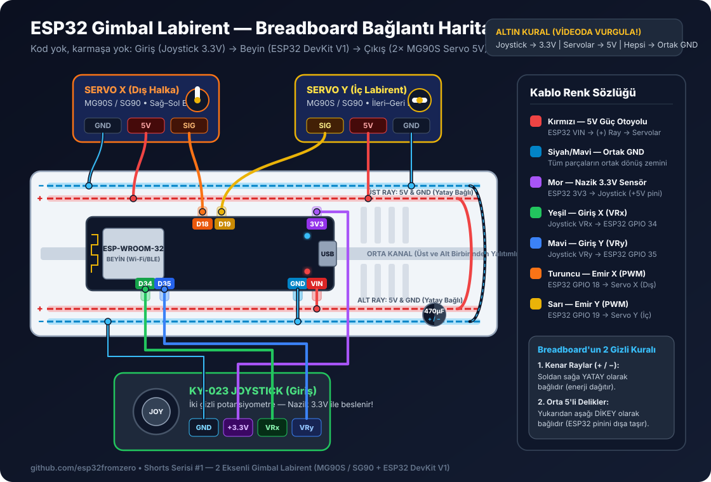

# 07 · 2 Eksenli 3D Baskı Gimbal Labirent (Blender + ESP32 Breadboard X-Ray)

`esp32-from-zero` serisi için hazırlanan; **Blender 5.2 ile parametrik olarak modellenmiş 3D baskı 2 eksenli gimbal labirent** ve **kodlama karmaşasına girmeden breadboard / kablo mantığını öğreten 9:16 Shorts X-Ray animasyon projesi**.

| 3D Baskı Gimbal Labirent (Montajlı) | 3D Baskı Tablası Düzeni (Desteksiz) |
| :---: | :---: |
|  |  |

| Shorts 9:16 X-Ray (1/6 Boş Breadboard) | Shorts 9:16 X-Ray (6/6 Tam Sistem & Sinyal Akışı) |
| :---: | :---: |
|  |  |

---

## 📌 1. Projenin Amacı ve Anlatım Felsefesi

Bu proje özellikle **YouTube Shorts / Reels / TikTok** formatında izleyiciyi kod satırlarıyla sıkmadan **donanımın fiziksel çalışma mantığını** öğretmek üzere kurgulandı:

1. **Breadboard'un Gizli Mimarisi (X-Ray):**
   * Kenardaki kırmızı `(+)` ve mavi `(-)` çizgilerin altındaki metal şeritler **yatay (boydan boya)** uzanan güç otoyollarıdır.
   * Ortadaki `a-b-c-d-e` ve `f-g-h-i-j` delik gruplarının altında ise **dikey 5-parmaklı fosfor-bronz yay klipsleri** bulunur; aynı sütundaki 5 deliği birbirine bağlar, orta kanal (`DIP ravine`) ise üst ve alt yarıyı birbirinden yalıtır.
2. **İki Farklı Güç Seviyesi, Tek Ortak Zemin (`Common GND`):**
   * **Servolar (Kaslar):** Yük altında tork üretmek için güçlü **`5V` (`VIN`)** hattından beslenir.
   * **Joystick (Duyu/Giriş):** İçinde iki adet `10kΩ` potansiyometre bulunur. ESP32'nin analog okuma (`ADC`) pinleri maksimum **`3.3V`** toleranslı olduğu için Joystick'in `+5V (VCC)` pini mutlaka ESP32'nin **`3V3`** pinine bağlanır.
   * **Ortak GND:** Hem `5V` hem `3.3V` devresi aynı **Mavi `(-)` GND** rayında buluşur.
3. **Giriş → Beyin → Çıkış Döngüsü:**
   * **Giriş:** Joystick kolu hareket ettikçe `VRx` ve `VRy` pinlerindeki analog voltaj (`0V .. 3.3V`) değişir ve `GPIO 34` / `GPIO 35` üzerinden ESP32'ye ulaşır.
   * **Beyin (ESP32):** `12-bit ADC` (`0 .. 4095`) değerini okur, titremeyi filtreler ve güvenli eğim açısına (`90° ± 24°`) dönüştürür.
   * **Çıkış:** `GPIO 18` (Turuncu) dış gimbal halkasını sağa-sola, `GPIO 19` (Sarı) iç labirent tablasını ileri-geri yatırır.

---

## 🧰 2. Malzeme Listesi (BOM)

| Adet | Parça | Teknik Detay & Seçim Nedeni |
| :---: | :--- | :--- |
| **1** | **ESP32 DevKit V1** (30-pin) | Klasik `ESP-WROOM-32` geliştirme kartı (38-pin versiyonlarla da çalışır) |
| **2** | **MG90S Metal Dişli Mikro Servo** | Metal dişli olduğu için boşluk (backlash) yapmaz; **SG90** ile birebir aynı kasa ölçüsündedir (`22.8 × 12.2 mm`) |
| **1** | **KY-023 Analog Joystick Modülü** | Çift eksenli (`VRx`, `VRy`) + basma butonlu (`SW`) standart modül |
| **1** | **400 Delikli (Half-Size) Breadboard** | Standart `2.54 mm` (`0.1 inch`) adımlı, 30 sütunlu breadboard |
| **1** | **470µF Elektrolitik Kondansatör** | `5V (+)` ve `GND (-)` rayları arasına takılır; iki servo aynı anda ani akım çektiğinde voltaj çökmesini (brownout reset) önler |
| **1** | **8–10 mm Çelik Bilye** | Rulman bilyesi idealdir; yoksa `stl/05_yedek_bilye_10mm.stl` basılabilir |
| **4** | **M2×6 mm Vida** | Servoların kutusundan çıkan montaj vidaları |
| **15** | **Renk Kodlu Jumper Kablo** | Kırmızı, Siyah, Mor, Yeşil, Mavi, Turuncu, Sarı |

---

## 🔌 3. Adım Adım Breadboard Bağlantı Tablosu (6 Aşamalı Montaj)



> 💻 **İnteraktif Simülatör:** [`wiring/breadboard_interaktif.html`](wiring/breadboard_interaktif.html) dosyasını tarayıcıda açarak **X-Ray modunu** açıp kapatabilir, hatları grup grup inceleyebilir ve ekrandaki joystick ile 3D gimbal labirenti canlı test edebilirsin.

Blender animasyonundaki (`breadboard_xray_shorts.blend`) **tek tek takılma sırasıyla** tam pin eşleşmesi:

| Aşama | Animasyon Karesi | Kablo / Parça | Başlangıç Noktası | Bitiş Noktası (Breadboard) | Kablo Rengi | Görevi |
| :---: | :---: | :--- | :--- | :--- | :---: | :--- |
| **1/6** | `1 – 52` | **Breadboard** | — | — | — | X-Ray ile içteki 5'li dikey klipsler ve yatay raylar görünür |
| **2/6** | `55 – 89` | **ESP32 DevKit V1** | Sütun `3..17`, Satır `i` (üst) | Sütun `3..17`, Satır `b` (alt) | — | Orta kanalın üzerine oturur; `j` ve `a` satırları kablo için boş kalır |
| **3/6** | `90 – 103` | `01_W_ESP_5V` | ESP32 **`VIN` (5V)** (`Sütun 17, a`) | Alt **(+) Kırmızı Ray** (`Sütun 17`) | 🔴 Kırmızı | USB'den gelen 5V gücü alt kırmızı otoyola verir |
| **3/6** | `104 – 115` | `02_W_ESP_GND` | ESP32 **`GND`** (`Sütun 16, a`) | Alt **(-) Mavi Ray** (`Sütun 16`) | ⚫ Siyah | Ortak GND referansını alt mavi otoyola verir |
| **3/6** | `116 – 123` | `03_W_Bridge_5V` | Alt **(+) Kırmızı Ray** (`Sütun 27`) | Üst **(+) Kırmızı Ray** (`Sütun 27`) | 🔴 Kırmızı | Üst kırmızı rayı da 5V otoyoluna bağlar |
| **3/6** | `124 – 135` | `04_W_Bridge_GND` | Alt **(-) Mavi Ray** (`Sütun 28`) | Üst **(-) Mavi Ray** (`Sütun 28`) | ⚫ Siyah | Üst mavi rayı da ortak GND'ye bağlar |
| **3/6** | `136 – 149` | **470µF Kondansatör** | Alt **(+) Kırmızı Ray** (`Sütun 24`) | Alt **(-) Mavi Ray** (`Sütun 24`) | 🔵/⚪ | Anlık akım darbelerini sönümler (`-` şeritli bacak mavi raya!) |
| **4/6** | `150 – 163` | **KY-023 Joystick** | Breadboard alt önü | — | — | Giriş kontrolcüsü sahneye yerleşir |
| **4/6** | `164 – 173` | `05_W_Joy_GND` | Joystick **`GND`** | Alt **(-) Mavi Ray** (`Sütun 8`) | ⚫ Siyah | Joystick ortak zemin bağlantısı |
| **4/6** | `174 – 191` | `06/07_W_Joy_3V3` | ESP32 **`3V3`** (`Sütun 17, j` → `21`) | Joystick **`+5V (VCC)`** | 🟣 Mor | ADC pinlerini korumak için Joystick'i `3.3V` ile besler |
| **4/6** | `192 – 203` | `08_W_Joy_VRx` | Joystick **`VRx`** | ESP32 **`GPIO 34`** (`Sütun 6, a`) | 🟢 Yeşil | Sağ–Sol analog voltaj sinyali (`0..3.3V`) |
| **4/6** | `204 – 219` | `09_W_Joy_VRy` | Joystick **`VRy`** | ESP32 **`GPIO 35`** (`Sütun 7, a`) | 🔵 Mavi | İleri–Geri analog voltaj sinyali (`0..3.3V`) |
| **5/6** | `220 – 255` | **Servo X** + Güç | Servo X **`VCC` / `GND`** | Üst **(+)** (`Sütun 4`) / **(-)** (`Sütun 3`) | 🔴 / ⚫ | Dış gimbal halkası servosu 5V & GND bağlantısı |
| **5/6** | `256 – 274` | `12_W_SX_SIG` | Servo X **`Sinyal`** | ESP32 **`GPIO 18`** (`Sütun 9, j`) | 🟠 Turuncu | Dış halkaya PWM açı komutu taşır |
| **6/6** | `275 – 309` | **Servo Y** + Güç | Servo Y **`VCC` / `GND`** | Üst **(+)** (`Sütun 20`) / **(-)** (`Sütun 22`) | 🔴 / ⚫ | İç labirent servosu 5V & GND bağlantısı |
| **6/6** | `310 – 360` | `15_W_SY_SIG` | Servo Y **`Sinyal`** | ESP32 **`GPIO 19`** (`Sütun 8, j`) | 🟡 Sarı | İç labirente PWM açı komutu taşır; tüm sistem çalışır! |

---

## 🖨️ 4. 3D Baskı Parçaları & Mekanik Tolerans Detayları

Tüm parçalar [`blender/scripts/generate_gimbal_maze.py`](blender/scripts/generate_gimbal_maze.py) tarafından **gerçek milimetre ölçeğinde (`1 BU = 1.0 mm`, `scale_length = 0.001`)** ve **hiç destek (support) gerektirmeyecek şekilde** üretilmiştir:

| STL Dosyası | Dış Boyutlar (mm) | Mekanik Özellikler & Toleranslar |
| :--- | :---: | :--- |
| [`stl/01_taban_stand.stl`](stl/01_taban_stand.stl) | `140.0 × 86.0 × 88.0` | Gimbal eksen yüksekliği `Z = 72.0 mm` (`±25°` eğimde bile masa yüzeyine `>24 mm` güvenli boşluk kalır). Sağ kulede dikey MG90S/SG90 yuvası (`23.2 × 12.6 mm`, `+0.3 mm` toleranslı) ve alt kablo geçiş çentiği; sol kulede `4.3 mm` pivot deliği; kulelerde 45° desteksiz takviye payandaları. |
| [`stl/02_dis_gimbal_halka.stl`](stl/02_dis_gimbal_halka.stl) | `116.0 × 114.0 × 18.0` | İç boşluk `100.0 × 98.0 mm`, duvar kalınlığı `8.0 mm`. `+Y` duvarında Servo Y yatay yuvası (servo mili `5.4 mm` kaçıklık telafisiyle tam `X = 0` merkez eksenine hizalanmıştır!). `+X` dış yüzeyinde `2.2 mm` derinliğinde tek kollu servo horn gömme kanalı; `-X` ve `-Y` duvarlarında `4.3 mm` pivot delikleri. |
| [`stl/03_ic_labirent_tabla.stl`](stl/03_ic_labirent_tabla.stl) | `90.0 × 90.0 × 15.5` | `4.0 mm` taban + `11.5 mm` duvar yüksekliği. **5×5 garantili çözülebilir labirent** (tüm 25 hücreye ulaşan spanning-tree mimarisi), net koridor genişliği **`14.2 mm`** (`8–10 mm` çelik bilye köşelerde asla sıkışmaz). Sol altta `(0,0)` başlangıç yuvası, sağ üstte `(4,4)` `11.6 mm` çaplı × `2.8 mm` derinliğinde hedef çukuru. `+Y` kenarında Servo Y horn yuvası, `-Y` kenarında pivot deliği. |
| [`stl/04_pivot_pim_x2.stl`](stl/04_pivot_pim_x2.stl) | `22.4 × 8.4 × 20.6` | 2 adet şapkalı sürtünmesiz pivot pimi (`Ø3.84 mm` şaft → `Ø4.30 mm` delik içinde boşluksuz ve rahat döner). Alternatif olarak 2 adet `M3×16` vida + somun da kullanılabilir. |
| [`stl/05_yedek_bilye_10mm.stl`](stl/05_yedek_bilye_10mm.stl) | `10.0 × 10.0 × 9.6` | Çelik bilye yoksa tablaya yapışması için tabanı `0.35 mm` düzleştirilmiş desteksiz basılabilir küre. |

### Dilimleyici (Slicer) & Montaj Püf Noktaları
* **Katman Yüksekliği:** `0.20 mm` (`05_yedek_bilye_10mm.stl` için `0.12 mm` önerilir)
* **Duvar Sayısı (Wall Loops):** `3`
* **Dolgu (Infill):** `%15 – %20` Gyroid
* **Destek (Support):** `Kapalı (None)`
* **Kritik Montaj Kuralı:** Servoları vidalamadan ve beyaz servo kollarını (`horn`) yuvalara oturtmadan **ÖNCE** ESP32'ye kodu yükleyip enerji ver. Kod açılışta her iki servoyu da tam **`90°` yatay merkez açısına** getirir; kolları bu konumdayken tam yatay olarak yuvalarına oturt!

---

## 🛠️ 5. Sonra Üzerinde Çalışırken Nasıl Özelleştirilir? (Geliştirici Rehberi)

Projeyi ileride değiştirmek veya geliştirmek istediğinde her şey **parametrik Python scriptlerine** bağlıdır. Blender arayüzünde tek tek nesne kaydırmak yerine scriptteki değişkenleri güncelleyip tek komutla tüm `.blend`, `.stl` ve `.mp4` dosyalarını yeniden üretebilirsin.

### A) 3D Baskı Gimbal Labirenti Değiştirmek (`blender/scripts/generate_gimbal_maze.py`)
Scriptin en üstündeki parametreler:
* `Z_AXIS = 72.0` → Stand yüksekliği
* `SERVO_CUT_L = 23.2`, `SERVO_CUT_W = 12.6` → Yazıcının sıkılık toleransına göre `±0.2 mm` oynayabilirsin.
* `MAZE_SIZE = 90.0`, `MAZE_WALL_H = 11.5` → Labirent boyutu ve duvar yüksekliği.
* `build_inner_maze()` içindeki `open_passages` kümesi → `(col, row)` koordinat çiftleriyle hangi hücreler arasındaki duvarın açık olacağını belirler (`0..4` arası 5×5 ızgara). Labirent desenini değiştirmek için sadece bu listedeki komşulukları değiştirmen yeterlidir!

**Yeniden STL ve `.blend` üretmek için terminal komutu:**
```powershell
& "C:\Program Files\Blender Foundation\Blender 5.2\blender.exe" --background --python "C:\Users\emin\esp32-from-zero\projects\07-gimbal-maze\blender\scripts\generate_gimbal_maze.py"
```

### B) Shorts 9:16 X-Ray Animasyonunu Değiştirmek (`blender/scripts/generate_breadboard_xray.py`)
* **Parçaların Takılma Zamanlaması (`f_plug`):**
  * `build_esp32_detailed(..., f_plug=55)`
  * `make_animated_jumper_wire(..., f_plug=90..310)`
  * `build_capacitor_detailed(..., f_plug=136)`
  * `build_joystick_detailed(..., f_plug=150)`
  * `build_servo_detailed("Servo_X", ..., f_plug=220)`
  * `build_servo_detailed("Servo_Y", ..., f_plug=275)`
* **Üst 3D Adım Başlıkları (HUD):** `build_step_hud_banners()` içindeki `steps` listesinden Türkçe/İngilizce başlık metinlerini, renklerini ve başlangıç/bitiş karelerini değiştirebilirsin.
* **Kamera Hareketleri:** `main()` sonundaki `set_cam_key(frame, loc, target)` satırlarından yakınlaşma açısını ve hızını ayarlayabilirsin.

**Sahneyi güncelleyip yeniden 1080×1920 MP4 video render almak için:**
```powershell
# 1. Sahneyi (.blend) ve önizleme PNG karelerini güncelle:
& "C:\Program Files\Blender Foundation\Blender 5.2\blender.exe" --background --python "C:\Users\emin\esp32-from-zero\projects\07-gimbal-maze\blender\scripts\generate_breadboard_xray.py"

# 2. 360 karelik (12 sn) 1080x1920 MP4 videoyu render al:
& "C:\Program Files\Blender Foundation\Blender 5.2\blender.exe" --background "C:\Users\emin\esp32-from-zero\projects\07-gimbal-maze\blender\breadboard_xray_shorts.blend" --python-expr "import bpy; bpy.context.scene.eevee.taa_render_samples=32; bpy.ops.render.render(animation=True)"
```

### C) ESP32 Kodunu Özelleştirmek (`esp32_gimbal_maze/esp32_gimbal_maze.ino`)
* `CENTER_X = 90`, `CENTER_Y = 90`: Servo kolunu taktığında tabla tam su terazisinde düz durmuyorsa buradan `±5°` ince trim ayarı yapabilirsin.
* `MAX_TILT = 24`: Labirentin maksimum yatma açısı (daha hızlı/zor oyun için `28`, daha sakin oyun için `18` yapılabilir).
* `SMOOTHING = 0.16f`: Üstel alçak geçiren filtre katsayısı (`0.08f` çok yumuşak/ağırkanlı, `0.30f` çok tepkisel).
* `INVERT_X = false`, `INVERT_Y = false`: Joystick'i sağa ittiğinde labirent sola yatıyorsa ilgili ekseni `true` yapman yeterlidir.
* **Yeniden Kalibrasyon:** Oyun sırasında Joystick'in üstüne (`SW` butonu, `GPIO 25`'e bağlandıysa) bas하면 yeni duruş pozisyonunu merkez olarak sıfırlar.

---

## 📋 6. Sonraki Geliştirme Fikirleri (TODO / Roadmap)

Üzerinde tekrar çalışacağın zaman eklenebilecek geliştirmeler:
- [ ] **İngilizce + Türkçe Çift Dilli Shorts Render'ı:** `generate_breadboard_xray.py` içindeki `steps` HUD başlıklarını parametreye bağlayıp hem `EN` hem `TR` için otomatik iki ayrı MP4 üretmek (`esp32-from-zero` ana kanal dil yapısına uygun).
- [ ] **Hedef Sensörü (Bitiş Algılama):** Labirentin `(4,4)` hedef çukurunun altına küçük bir bakır folyo / limit switch veya TCRT5000 kızılötesi sensör koyup çelik bilye hedefe girdiğinde buzzer'dan zafer melodisi çaldırmak.
- [ ] **Bölüm 2 Shorts Fikri (Kablosuz Telefon Jiroskopu):** Aynı 3D baskı gimbal labirenti hiç kablo sökmeden ESP32 içinde açılan bir Web sayfası (`WebSockets` + telefonun `DeviceOrientation` sensörü) ile telefonu havada eğerek kontrol etmek.

---

## 📁 7. Klasör Yapısı

```text
projects/07-gimbal-maze/
├── README.md                              # Bu detaylı teknik rehber
├── SHORTS_SENARYO.md                      # Saniye saniye Shorts çekim, seslendirme ve kurgu planı
├── esp32_gimbal_maze/
│   └── esp32_gimbal_maze.ino              # Tak-çalıştır, otomatik kalibrasyonlu ESP32 DevKit V1 kodu
├── wiring/
│   ├── breadboard_sema.svg                # Renk kodlu vektörel breadboard bağlantı şeması
│   └── breadboard_interaktif.html         # Tarayıcıda çalışan interaktif X-Ray & 3D Gimbal simülatörü
├── blender/
│   ├── gimbal_maze_3dprint.blend          # 3D baskı modeli + hareketli montaj + baskı tablası
│   ├── breadboard_xray_shorts.blend       # 1080x1920 (9:16) 360 kare tek tek montaj & X-Ray sahnesi
│   └── scripts/
│       ├── generate_gimbal_maze.py        # Parametrik 3D baskı gimbal labirent üretici scripti
│       └── generate_breadboard_xray.py    # Parametrik 9:16 X-Ray breadboard animasyon üretici scripti
├── stl/
│   ├── 01_taban_stand.stl                 # Sabit U-Taban (140 x 86 x 88 mm)
│   ├── 02_dis_gimbal_halka.stl            # Dış Gimbal Halkası (116 x 114 x 18 mm)
│   ├── 03_ic_labirent_tabla.stl           # 5x5 İç Labirent Tablası (90 x 90 x 15.5 mm)
│   ├── 04_pivot_pim_x2.stl                # 2x Pivot Pimi
│   └── 05_yedek_bilye_10mm.stl            # Yedek 10mm 3D basılabilir bilye
└── previews/
    ├── gimbal_maze_assembled.png          # Montajlı 3D baskı render önizlemesi
    ├── gimbal_maze_print_plate.png        # 3D baskı tablası render önizlemesi
    ├── breadboard_xray_frame_solid.png    # 1/6 Boş X-Ray breadboard karesi
    ├── breadboard_xray_frame_xray.png     # 6/6 Tam sistem X-Ray & sinyal akışı karesi
    └── breadboard_xray_shorts.mp4         # 1080x1920 (30fps, 12 sn) tam animasyon videosu
```
